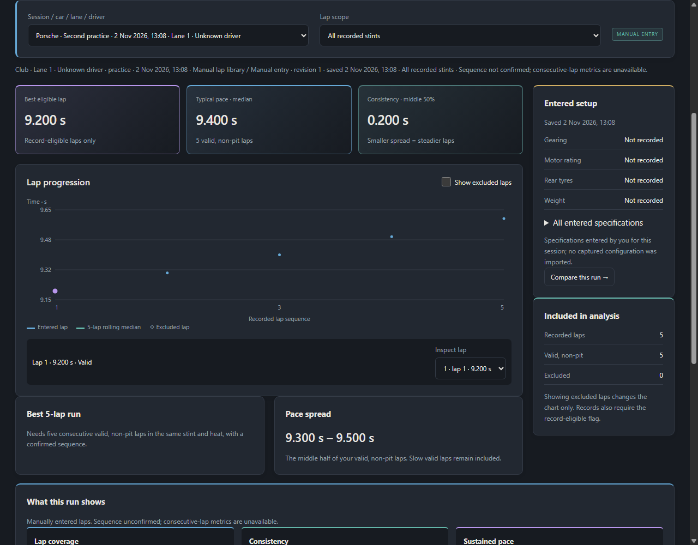
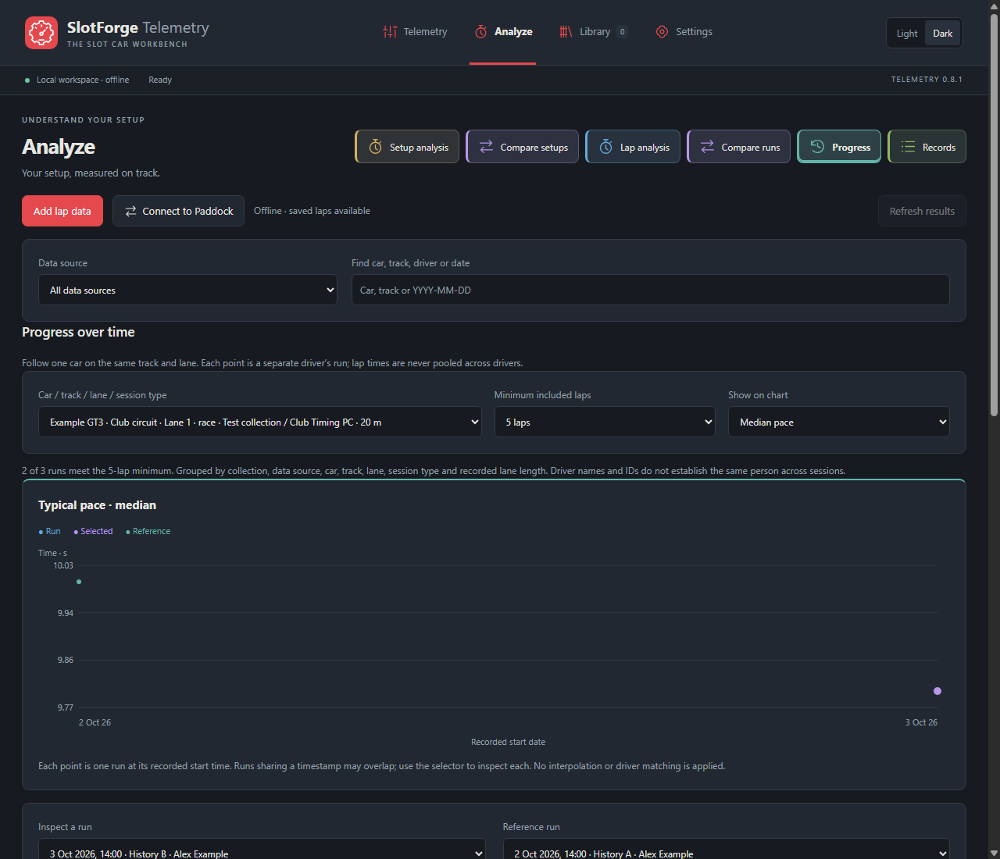

  
  

 

# SlotForge Telemetry

**Understand your setup. Analyse your laps. Compare what changes.**

SlotForge Telemetry is a desktop app for slotcar setup calculations and lap analysis. Explore gearing, motors, tyres and weight, save configurations, and compare theoretical performance with what you record on the track.

Start with the measurements you have. Enter lap times from another timer or notebook, or import delivered race sessions through SlotForge Paddock. **Calculations and saved lap analysis work offline, with no account or timing hardware required.**

[Download Telemetry](https://github.com/theDutchmanJames/SlotForgeTelemetry/releases/latest) · [See the app](#pictures-of-the-app) · [Explore the features](#features-and-functionality) · [How to install](#how-to-install) · [Report a problem](#reporting-problems)

## SlotForge App Collection

SlotForge Telemetry is part of the **SlotForge App Collection**—apps for building tracks, managing your cars, designing their appearance and exploring their performance.

-  **[SlotForge Paddock](https://github.com/theDutchmanJames/SlotForgePaddock)** — Organize your slotcar collection, photographs, parts, setups and maintenance in a virtual garage and workshop.
-  **[SlotForge Timing](https://github.com/theDutchmanJames/SlotForgeTiming)** — Run lap timing, practice sessions and races, manage heats and championships, and create custom race displays for analogue slot-car tracks.
-  **[SlotForge Decals](https://github.com/theDutchmanJames/SlotForgeDecals)** — Size and arrange artwork into decal sheets, then export a PDF for printing.
-  **[SlotForge Livery](https://github.com/theDutchmanJames/SlotForgeLivery)** — Plan paint schemes, stripes, race numbers and decals on editable 2D car templates.
-  **[SlotForge Circuit](https://github.com/theDutchmanJames/SlotForgeCircuit)** — Design slotcar tracks, including routed and FreeForm layouts, and export track data for Timing's Live Tracker.

Visit each app's repository for its features, downloads and getting-started guide. Circuit was previously called SlotForge Track Builder; its repository is now SlotForgeCircuit.

The original motor/gearing engine and vector icons come from Paddock. The colours and navigation follow the family. See [source notices](SOURCE-NOTICES.txt).

## Pictures of the app

<table>
  <tr><th width="50%">Build a setup · live calculations</th><th width="50%">Explore performance · curves and results</th></tr>
  <tr>
    <td></td>
    <td></td>
  </tr>
</table>

*Screenshots from the app using example setups and sample lap data. Click any image for a closer look.*

  
<strong>Explore comparisons, lap analysis, Progress and the setup library</strong>

<table>
  <tr><th width="50%">Compare two saved setups</th><th width="50%">Keep your setup experiments</th></tr>
  <tr>
    <td></td>
    <td></td>
  </tr>
</table>

<table>
  <tr><th width="50%">Analyse manually entered laps</th><th width="50%">Follow performance across sessions</th></tr>
  <tr>
    <td></td>
    <td></td>
  </tr>
</table>

<table>
  <tr><th width="50%">Understand ballast placement</th><th width="50%">Explore tyre wear and clearance</th></tr>
  <tr>
    <td></td>
    <td></td>
  </tr>
</table>

## Features and functionality

### Build a setup and see the numbers change

**Try a change before reaching for the tools.** The Telemetry workbench updates its results as you enter gear teeth, rear tyre size, motor ratings and weight. Start with a pinion, driven gear and fitted tyre diameter; add the motor and other measurements when available.

Use a measured tyre diameter or calculate it from rim diameter and radial tyre thickness. The **Setup inputs** shortcuts take you directly to Gearing, Motor, Tyres & clearance, Weight & ballast, Gear finder and Lap speed.

| Calculation | What it helps you understand |
| --- | --- |
| **Gear ratio and axle RPM** | How pinion and driven-gear teeth change the reduction and no-load rear-axle speed. |
| **Rollout** | How far the car travels per motor revolution for the chosen gearing and tyres. |
| **Theoretical speed** | The no-load speed implied by motor RPM, gearing and fitted tyre diameter. |
| **Axle torque and driving force** | How gearing and tyre diameter translate a confirmed motor torque rating into ideal force at the track. |
| **Motor power** | Estimated peak mechanical power and the motor RPM at which it occurs. |
| **Weight and ballast** | Power per kilogram and ideal acceleration before and after adding weight. |
| **Drivetrain efficiency** | Estimated wheel power and force at a chosen operating point, using your assumed losses. |
| **Measured lap speed** | Average speed from lane length and lap time, with an optional scale-equivalent conversion. |

Motor torque is entered in **gf·cm**—gram-force centimetres. Power curves require a brushed DC motor, confirmed **stall torque**, and matching positive RPM/torque test voltages. Leave uncertain inputs blank or marked **Unknown**; unavailable results show a dash.

### Explore motor performance and compare setups

Save a setup, then open **Analyze → Setup analysis**. Torque and power curves show how the ideal motor model changes with speed. Move the motor-speed slider to explore torque, power, axle RPM, vehicle speed and driving force at the same operating point.

**Compare setups** puts two saved configurations side by side in a simple table. See absolute and percentage changes, with colour highlights for selected performance metrics. Gearing, rollout, mass and measured lap averages remain neutral tradeoffs: a higher theoretical top speed does not automatically mean a faster car around your track.

For example, save your current 9-tooth pinion setup, change it to 10 teeth and choose **Save as copy**. Compare the speed, torque and rollout of both configurations before testing the change on the track.

### Plan ballast, tyre wear and gear choices

**Weight & ballast** explores total mass, static front/rear axle loads and longitudinal centre of gravity. Enter wheelbase, axle scale readings and the position of added ballast to see how weight is distributed. Take readings on a level surface, with the guide clear and no magnetic pull on the scales.

**Tyre wear & clearance** shows how a smaller tyre changes rollout, theoretical speed, ideal driving force and rear axle height. Enter the driven gear's measured outside diameter, including tooth tips, to check nominal ground clearance. The app identifies contact or interference when the gear reaches below the tyre contact plane.

**Gear finder** searches your chosen tooth-count ranges and lists the closest 20 combinations for a target rollout. It can also help compensate for a change in tyre diameter. Check the physical pitch, mesh and fit of any suggested combination before using it.

### Bring your own lap times

**You do not need Paddock or Timing to use lap analysis.** Choose **Analyze → Lap analysis → Add lap data** and type or paste times from another timing app, a spreadsheet or a notebook.

- Enter one lap time per line, or lap-number/time columns separated by tabs or semicolons.
- Use seconds, decimal commas, minutes:seconds or whole milliseconds.
- Add the car, track, lane and session date; optionally record the driver, source, lane length, notes and setup specifications.
- Review the parsed times and mark invalid or pit laps before saving.
- Edit sessions later without creating duplicate records, or delete them through **Library → Race results**.

Confirm the sequence only when the times form one consecutive stint. Numbered input preserves missing-lap gaps; selected or unordered laps can still be analysed without claiming continuous runs. Generic CSV files with arbitrary columns are not imported automatically. [Manual lap-entry guide](docs/PADDOCK-RESULTS.md#manual-lap-data-without-paddock).

### Read race sessions from Paddock

Connect to a compatible **SlotForge Paddock** host on your local network through **Settings → Connect to Paddock**. Find it automatically or enter the address and port shown by Paddock, then connect with its Dealership password.

Telemetry imports reviewed sessions that **SlotForge Timing has already delivered to Paddock**, including measured laps and captured car configurations. Import once and analyse the saved results offline. Refresh retrieves new or corrected sessions; supported hosts can notify Telemetry of changes while connected. Corrections replace previous versions, and withdrawn or quarantined sessions stop contributing to analysis and records.

The connection is read-only: Telemetry does not change Paddock's cars or Timing's race results. Passwords stay in memory and are forgotten on disconnect or exit. **Telemetry analyses recorded data; it does not time laps or receive live sensor readings.** [Connection and recovery guide](docs/PADDOCK-RESULTS.md).

### Understand pace, consistency and stints

**Lap analysis** turns a saved run into a chart, clear statistics and an inspectable lap table:

- **Best eligible lap:** the quickest lap that qualifies for a record.
- **Typical pace:** the median of valid, non-pit laps, rather than just the fastest lap.
- **Consistency:** the spread of the middle half of those laps; a smaller spread means steadier times.
- **Rolling pace:** a five-lap rolling median where a continuous sequence is known.
- **Best five-lap run:** the fastest average across five uninterrupted valid, non-pit laps.
- **Stint analysis:** focus on a recorded stint and inspect its pace, lap counts and exclusions. Opening/closing pace compares the first and last five laps of a continuous sequence of at least ten laps.

Pit and invalid laps stay available for inspection but are excluded from pace statistics. Slow valid laps remain included. Missing or excluded laps break consecutive sequences, and insufficient data leaves the relevant metric unavailable. Imported configurations remain tied to the recorded race; manually entered specifications are clearly labelled.

### Compare runs, follow Progress and share reports

**Compare runs** starts with a straightforward numerical comparison. Optional **Lap progression** overlays two runs on the same time scale, with solid/dashed traces and gaps for excluded laps. This compares recorded lap sequences; it is not a live race gap or sector analysis.

Benefit colours require compatible runs and your confirmation that the driver and conditions are comparable. Track, lane, source and known session/length differences matter. The app's observations explain changes in best lap, median pace, consistency and sample size without claiming that a setup change caused the difference.

**Progress** follows a car across sessions on the same track and lane. Choose median pace, best lap or consistency, set a minimum lap count, and compare a selected run with a reference. Review captured specification and component changes alongside the results. Sources and session types remain separate; runs from different drivers are not pooled.

**Records** lists the best eligible laps in the data held by Telemetry, with manual and imported evidence kept separate. It is not a complete copy of Timing's official record database.

Use **Export comparison report** in Compare runs or Progress to save a self-contained HTML report. Open it in a browser to read, share or print. It includes statistics, observations, setup differences and source context, with supplied classifications and penalties kept separate from measured lap times. Reports are snapshots and do not update after later corrections.

### Keep setups and lap libraries organised

In **Library**, save named setups with notes, search and sort them, and load, rename, duplicate or delete entries. Open a setup directly in Analyze or Compare. Share individual configurations through **Export file / Open file**.

The working draft is saved automatically on this computer. **Analyze uses saved setups**, so choose **Save setup** after changes you want to analyse. **Save as copy** preserves the original for comparison.

Backups are separate for each kind of data:

| Data | Backup and recovery |
| --- | --- |
| **Saved calculator setups** | **Library → Export library** saves your entries and notes. **Import library** adds copies, keeping existing entries. Save a working draft first to include it; appearance settings are not included. |
| **Manual lap sessions** | **Library → Race results → Manual lap library → Back up manual laps**. **Restore backup** merges new entries and skips unchanged ones; conflicting revisions stop the restore rather than overwrite edits. |
| **Imported Paddock results** | **Export results** saves evidence for inspection or a separate copy. That export cannot currently be restored into Telemetry; reconnect to Paddock and import again for recovery. |

Keep backup files somewhere separate from the computer running the app. Recovery controls preserve unreadable libraries before restoring or rebuilding them. There is no cloud sync. [Lap-library backup and recovery details](docs/PADDOCK-RESULTS.md#library-and-backup).

### Choose your theme and understand the calculations

Choose from eight family presets or create a custom palette in **Settings**. The **Light / Dark** switch remembers your preferred theme for each mode.

**Settings → Calculations explained** provides formulas, worked examples and assumptions. **Try it in Telemetry** takes you directly to the relevant input.

Use the calculations to plan tests and understand tradeoffs:

- No-load speed is a theoretical ceiling. Stall force applies at zero speed, not at that top speed.
- Estimated mechanical power is not electrical consumption or a continuous motor rating.
- Ideal acceleration excludes grip limits, rotating inertia and drag. Static ballast balance does not predict handling or lap time.
- Nominal clearance does not account for tyre compression, gear runout or track irregularities.
- Scale speed is a size conversion, not a prediction of full-size vehicle performance. Test voltages do not rescale motor ratings.

## How to install

Open the **[latest GitHub release](https://github.com/theDutchmanJames/SlotForgeTelemetry/releases/latest)** and expand **Assets** to see the downloads. Choose the packaged app for your computer. **No coding, Terminal or Node.js is needed.** GitHub's **Source code** ZIP and tar.gz files are for building the app yourself.

| Your computer | Choose this file |
| --- | --- |
| **Windows · Intel/AMD 64-bit** | The file ending in **windows-x64-Portable.exe**. |
| **macOS · Intel or Apple Silicon** | The file ending in **mac-universal.dmg**. One download supports both processors; a ZIP of the same app is also available. |
| **Linux · Ubuntu/Debian/Mint, 64-bit Intel/AMD** | The file ending in **linux-amd64.deb**. |
| **Linux · other compatible distributions, 64-bit Intel/AMD** | The file ending in **linux-x86_64.AppImage**. |

### Windows

1. Download the portable **.exe** and move it to a folder you want to keep, such as **Documents → SlotForge Telemetry**.
2. Double-click it to start. There is no installation wizard.
3. Create a shortcut or pin the app to your taskbar for easy access.

The Windows build is unsigned. If Windows shows **Windows protected your PC**, verify that the file came from this repository. If you trust it and Windows offers the option, choose **More info → Run anyway**. Ask your administrator if a managed computer blocks it.

Portable means no installer is needed; saved data still lives separately in your user profile. Copying the executable to a USB stick does not copy your libraries.

### macOS

1. Download and open the universal **.dmg**.
2. Drag **SlotForge Telemetry** into **Applications**.
3. Open the app from Applications, then eject the disk image in Finder.

The Mac build is ad-hoc signed, not Apple Developer ID signed or notarised. If macOS blocks the first launch, try opening the app, then use **System Settings → Privacy & Security → Open Anyway**, if offered and you trust the download. [Apple's first-launch guidance](https://support.apple.com/en-us/102445).

If you prefer the ZIP, double-click it to extract the app, move it into Applications and open it there.

### Linux

**Ubuntu, Debian and Mint:** download the **.deb**, open it with your software installer and choose **Install**. If double-clicking does not open an installer, use **Open With → Software Install**, **GDebi**, or your distribution's equivalent. Launch Telemetry from the applications menu.

**AppImage:** save the file in a folder you want to keep. Right-click it, open **Properties → Permissions** and enable **Allow executing file as program** or the equivalent option, then double-click the file.

Some distributions need FUSE support for AppImages or have additional Electron sandbox requirements. If it will not open, keep the exact error and consult your distribution's supported instructions; try the DEB on Debian-based systems. Do not run the app as root or disable its sandbox to work around an error.

### Your first setup in five minutes

1. Open **Telemetry** and try the included example, or choose **Load example**.
2. Name your setup and enter the pinion, driven gear and fitted rear tyre diameter.
3. Add motor RPM and its test voltage; add torque and weight if known.
4. Choose **Save setup**, add notes and open **Analyze** to explore the saved configuration.
5. Make one change, choose **Save as copy** and compare the two setups. For actual track results, use **Add lap data** or connect to Paddock.

### Updating and moving to another computer

Back up your setup library and manual laps, then close Telemetry. Download the newer app from Releases. Open the new executable on Windows, replace the app in Applications on Mac, or install the new DEB/replace the AppImage on Linux.

Your existing user profile is retained. Check your libraries before removing the old program. Moving to another computer requires separate setup/manual-lap imports and a fresh Paddock import for its results. Earlier local builds used the name **SlotForge Calculator**; that profile folder is deliberately retained.

For source builds and contributor checks, see the [build guide](docs/BUILDING.md).

## Reporting problems

Open an **[issue on GitHub](https://github.com/theDutchmanJames/SlotForgeTelemetry/issues)** and include:

- Telemetry version, operating system and the download you used.
- What you were doing, what you expected and what happened instead.
- Steps to reproduce the issue, the exact error and a screenshot if useful.
- For calculations: input values, units, motor rating type and test voltages.
- For lap data: whether it was entered manually or imported from Paddock, plus a small example. For connection issues, include both app versions and which computer hosts Paddock.

Do not post passwords or unredacted backups. Remove private notes and identifying details from examples. Feature suggestions are welcome—describe the task you want to make easier.

**Before reporting a calculation issue:** a dash usually means missing or unsupported inputs. Power curves need confirmed brushed DC stall torque and matching positive rating voltages. If Analyze shows an older setup, save your changes first; it displays the saved library entry.

## License and copyright

Copyright © 2026 **theDutchmanJames and contributors**. SlotForge Telemetry uses the **[SlotForge Source-Available License 1.0](LICENSE)**.

- **Free to use** for personal, educational, club and internal business use.
- **Free to study, modify and share without charging**, retaining the licence and notices and identifying modifications.
- **No selling the software or charging for access**, including modified, bundled or hosted versions, without separate written permission from the relevant copyright holders.
- **Your own original content can be used commercially**, including measurements, race results and reports, subject to third-party rights.
- Voluntary donations are allowed when access and use do not depend on payment.

These are custom **source-available** terms, not an unrestricted open-source licence. The [full licence](LICENSE) governs use. Electron and other third-party components retain their own licences. See [source provenance and notices](SOURCE-NOTICES.txt).
