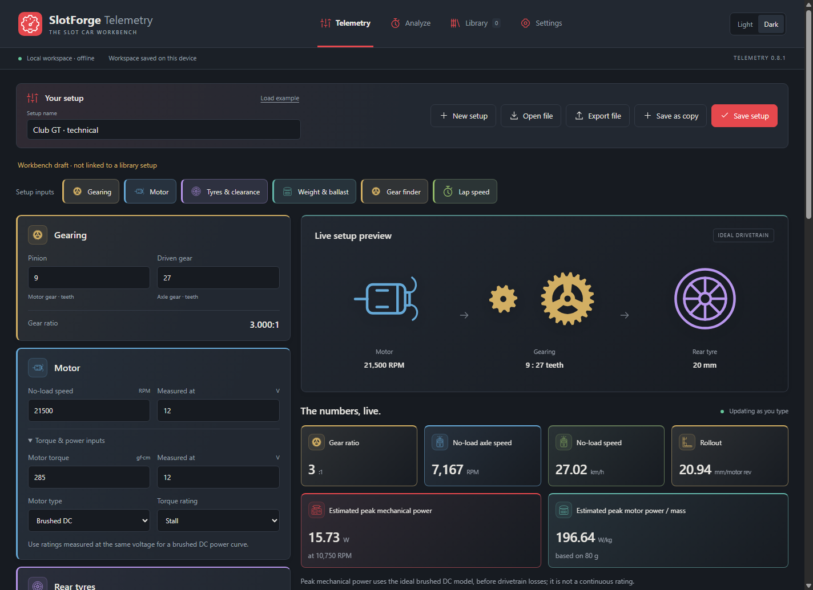
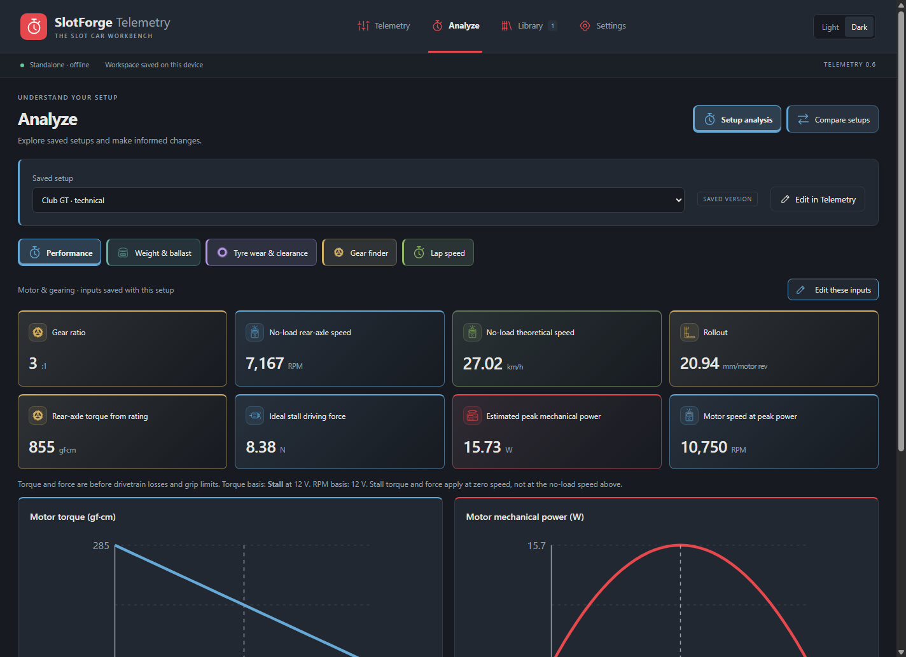
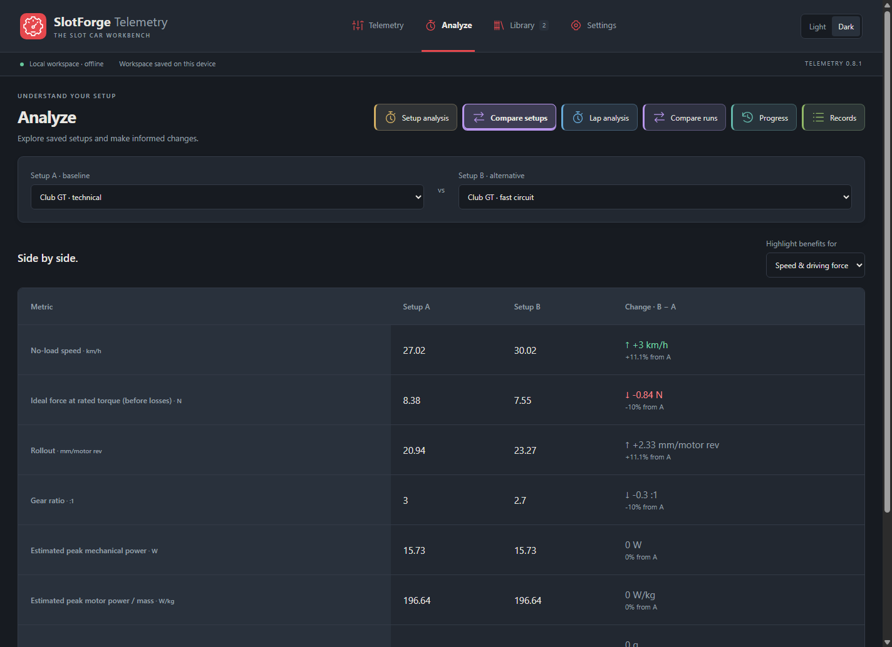
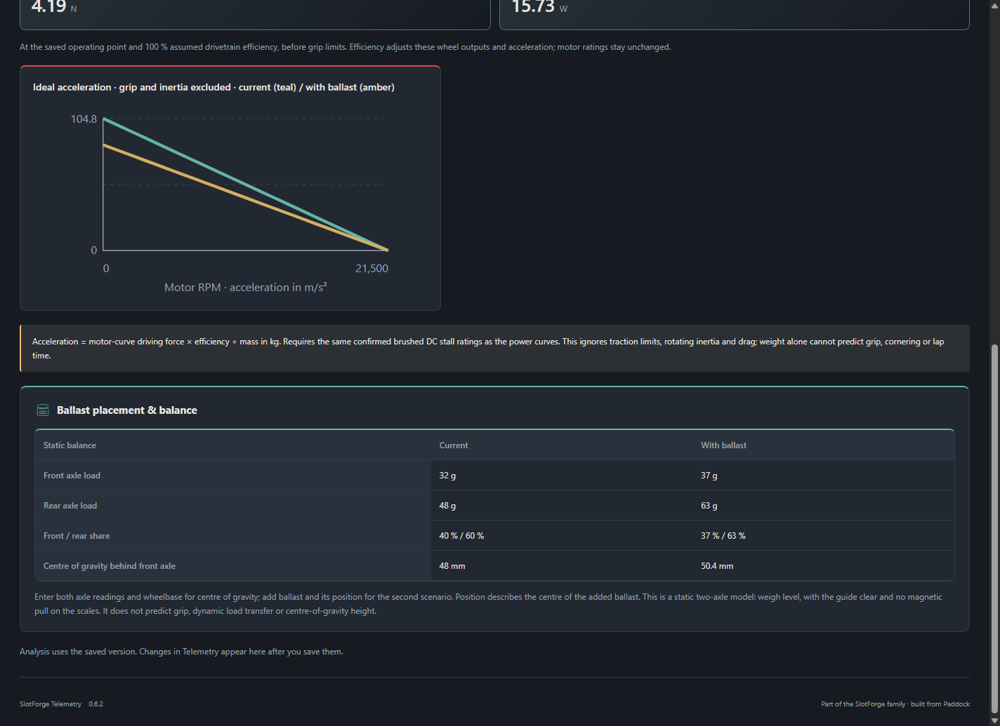
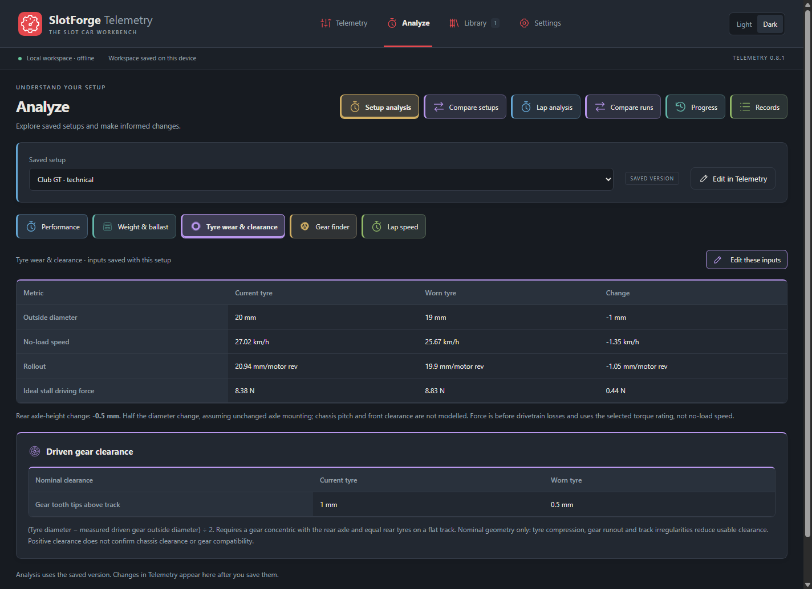
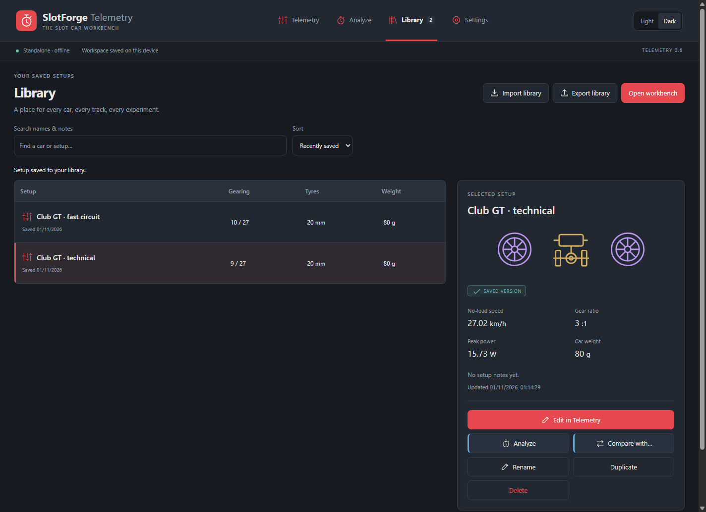

  

# SlotForge Telemetry

**Understand your slotcar setup. Compare your options. Keep what works.**

SlotForge Telemetry is a desktop calculator for slotcar gearing, motors, tyres and weight. See what changing a pinion or truing a tyre means, explore the numbers behind a saved setup, and keep your experiments in a personal library.

Start with gear tooth counts and tyre diameter. Add motor ratings, weight, ballast or measured lap times whenever you want to go further. **You only need to enter the information you have.**

**Version 0.8.1.** The app works offline, with no account or timing hardware required.

**New in 0.8.1:** A new Gear & dial app icon, combining mechanical setup and performance.

**Lap analysis:** Enter lap times from any timer or notebook, analyze stints, follow Progress history and export comparison reports. Paddock imports remain available with a compatible Paddock host. See [connecting to Paddock](docs/PADDOCK-RESULTS.md).

**[Download SlotForge Telemetry](https://github.com/theDutchmanJames/SlotForgeTelemetry/releases/latest)** — choose your computer below. No coding, Terminal or Node.js is needed to use the packaged app.

[Install](#download-and-install) · [First setup](#your-first-setup-in-five-minutes) · [Features](#what-you-can-do) · [Backups and updates](#keep-your-setups-safe) · [Help](#questions-and-troubleshooting)

*The workbench with example data. Click any screenshot to see it full size.*

## Download and install

Open the [latest release](https://github.com/theDutchmanJames/SlotForgeTelemetry/releases/latest) and scroll to **Assets**—GitHub's name for downloadable files—or use the direct links below.

| Your computer | Download | What to do |
| --- | --- | --- |
| **Windows, 64-bit Intel/AMD** | [Windows Portable.exe](https://github.com/theDutchmanJames/SlotForgeTelemetry/releases/download/v0.8.1/SlotForgeTelemetry-0.8.1-windows-x64-Portable.exe) | Save it, then double-click it. |
| **Mac, Apple Silicon or Intel** | [Mac universal.dmg](https://github.com/theDutchmanJames/SlotForgeTelemetry/releases/download/v0.8.1/SlotForgeTelemetry-0.8.1-mac-universal.dmg) | Open it and drag the app into Applications. |
| **Ubuntu, Debian or Mint, 64-bit Intel/AMD** | [Linux.deb](https://github.com/theDutchmanJames/SlotForgeTelemetry/releases/download/v0.8.1/SlotForgeTelemetry-0.8.1-linux-amd64.deb) | Open with your system's software installer. |
| **Other Linux desktops, 64-bit Intel/AMD** | [Linux.AppImage](https://github.com/theDutchmanJames/SlotForgeTelemetry/releases/download/v0.8.1/SlotForgeTelemetry-0.8.1-linux-x86_64.AppImage) | Allow it to run as a program, then double-click it. |

The Mac ZIP contains the same app as the DMG. The configured Linux release target is x64; the source builder supports an ARM64 Linux host.

**Choose an app file from this table.** GitHub's **Source code (zip)**, **Source code (tar.gz)** and **Code → Download ZIP** contain the ingredients for making the app, rather than a ready-to-run program. You do not need them for normal use.

### Windows: download, save, open

1. Click **Windows Portable.exe** in the table above. Your browser normally saves it in **Downloads**.
2. Move the file somewhere easy to find, such as a **SlotForge Telemetry** folder inside **Documents**.
3. Double-click **SlotForgeTelemetry-0.8.1-windows-x64-Portable.exe**. There is no installation wizard.
4. Try the included example. For easier access later, create a shortcut or pin the running app to your taskbar.

The Windows build is unsigned, so Windows may show **unknown publisher** or **Windows protected your PC**. Check that you downloaded it from this repository. If you trust the download and Windows offers it, choose **More info → Run anyway**. On a managed work or school computer, ask your administrator if it is blocked. Do not turn off antivirus protection.

**Portable means no installer is needed.** Setups are stored in your Windows user profile, separately from the executable. Copying the program onto a USB stick does not copy your library; use **Library → Export library** to take your setups with you.

### macOS: drag into Applications

1. Download **Mac universal.dmg**. One download supports both Apple Silicon and Intel Macs.
2. Double-click the downloaded file.
3. Drag **SlotForge Telemetry** onto the **Applications** folder in the window.
4. Open **Applications**, then open **SlotForge Telemetry**.
5. Eject the mounted disk image in Finder after copying the app.

The Mac build is ad-hoc signed, but **not notarized or signed with an Apple Developer ID**. macOS may block its first launch. After trying to open it, use **System Settings → Privacy & Security → Open Anyway**, if offered and you trust this download. See [Apple's guidance on opening apps safely](https://support.apple.com/en-us/102445). Do not disable Gatekeeper.

If you choose the ZIP, double-click it to extract **SlotForge Telemetry.app**, move that app into **Applications**, then open it there.

### Linux: use your software installer or an AppImage

**Ubuntu, Debian and Mint: start with the DEB.**

1. Download **Linux.deb**.
2. Open **Downloads** and double-click the file. If needed, right-click it and choose **Open With → Software Install**, **GDebi**, or your distribution's package installer.
3. Click **Install** and enter your computer password if requested.
4. Open **SlotForge Telemetry** from your applications menu.

Installer names vary. If there is no graphical DEB installer, use your Software Manager to find one, or ask your distribution's support community for help installing a local package.

**For an AppImage:**

1. Download **Linux.AppImage** and move it into a folder you want to keep, such as **Applications** in your home folder.
2. Right-click it and open **Properties → Permissions**.
3. Enable **Allow executing file as program**, **Executable**, or the equivalent option.
4. Close Properties and double-click the AppImage.

Some Linux systems need FUSE support for AppImages or restrict Electron's sandbox. Keep any error message and check [Troubleshooting](#questions-and-troubleshooting). Prefer the DEB on supported Debian-based systems. Do not disable the sandbox or run the app as root to work around an error.

## Your first setup in five minutes

1. Open **Telemetry**. The app starts with an example; **Load example** restores it whenever you want to try it again.
2. Give your setup a name, such as **Club GT · short circuit**.
3. Enter **pinion** and **driven gear** tooth counts, then the fitted rear tyre diameter measured after truing. Alternatively, choose **Rim + tyre thickness**.
4. Add the motor's **no-load RPM** and its test voltage. The live gearing, rollout and theoretical speed update as you type.
5. Add torque and weight if you have them. Power estimates require **Brushed DC**, confirmed **Stall** torque, and matching RPM/torque test voltages. Leave uncertain inputs blank or marked **Unknown**.
6. Click **Save setup**, add any notes and confirm.
7. Open **Analyze**, select your saved setup and explore the results.

The **Setup inputs** buttons at the top jump to **Gearing**, **Motor**, **Tyres & clearance**, **Weight & ballast**, **Gear finder** and **Lap speed**. Analyze also provides **Edit these inputs** for each topic.

**Try a comparison:** load a saved setup in Telemetry, change the pinion from 9 to 10 teeth, and choose **Save as copy** with a new name. Open **Analyze → Compare setups** and select the original and revised setups.

Your working draft is saved automatically on this computer. **Analyze uses saved library entries**, so click **Save setup** after changes you want to analyze. **Save as copy** preserves the original and adds another entry.

## What you can do

### Telemetry: see changes as you make them

| Tool | What it helps you understand |
| --- | --- |
| **Gearing and rollout** | Gear ratio, no-load axle RPM and travel per motor revolution. |
| **Theoretical speed** | The no-load speed implied by motor RPM, gearing and fitted tyre diameter. |
| **Torque and force** | Ideal axle torque and driving force from a confirmed motor torque rating. Stall force is identified as a zero-speed value. |
| **Motor power** | Estimated peak mechanical power and its RPM using the ideal brushed DC model. |
| **Weight and ballast** | Peak power per kilogram and ideal acceleration before/after adding ballast. |
| **Drivetrain losses** | Estimated wheel force and power at the saved operating point using your assumed efficiency. |
| **Ballast placement** | Static front/rear loads and longitudinal centre of gravity before/after adding ballast between the axles. |
| **Tyre wear** | Changes in rollout, speed, ideal force and rear axle height at a smaller tyre diameter. |
| **Gear clearance** | Nominal clearance from tyre and measured gear outside diameter, with contact/interference warnings. |
| **Gear finder** | The closest 20 whole-tooth combinations in your chosen ranges for a target rollout, including tyre-wear compensation. |
| **Lap speed** | Measured average speed from lane distance and lap time, plus scale-equivalent speed. |

For ballast balance, enter wheelbase and level axle scale readings with the guide clear and no magnetic pull on the scales. For clearance, enter the gear's **measured outside diameter**, including tooth tips, rather than tooth count.

### Analyze: explore or compare saved setups

Move the motor-speed slider to explore torque, power, axle RPM, speed and force at the same operating point. Separate topics cover weight/ballast, tyre wear/clearance, gear candidates and measured lap speed.

**Compare setups** shows two saved configurations without graphs. View absolute and percentage changes, with green/red highlights for higher/lower selected metrics. Gearing, rollout, mass and measured lap averages remain neutral tradeoffs. A higher theoretical speed does not automatically mean a faster lap.

| Explore the motor | Compare two setups |
| :---: | :---: |
|  |  |

| Ballast placement | Tyre and gear clearance |
| :---: | :---: |
|  |  |

### Library: keep every useful experiment

- Save named setups with notes about the car, circuit or change you are testing.
- Search names and notes; sort alphabetically or by most recently saved.
- Load, rename, duplicate or delete entries, with undo for the last deletion while available.
- Open entries directly in Analyze or Compare.
- Export/import your whole library for backup and transfer; imports add copies and keep existing entries.
- Share a single setup using **Export file / Open file** in Telemetry.

### Settings: your theme, and the calculations explained

Choose eight family presets or create a custom palette. The **Light / Dark** switch remembers your preferred theme for each mode.

**Settings → Calculations explained** provides formulas, plain-language explanations, worked examples and assumptions. **Try it in Telemetry** takes you to the relevant input.

## What the numbers mean

Telemetry combines exact arithmetic with simplified physical models. Use it to understand tradeoffs and plan track tests.

- **No-load speed is a theoretical ceiling**, not predicted actual top speed. Stall force applies at zero speed.
- **Peak power is estimated mechanical output**, not electrical consumption, continuous power or a thermal rating.
- **Ideal acceleration excludes grip limits, rotating inertia and drag.** Ballast balance is static; neither predicts handling or lap time.
- **Clearance is nominal geometry.** Tyre compression, gear runout, track irregularities and chassis clearance need checking.
- **Gear-finder matches are mathematical.** Confirm actual parts fit, pitch and mesh.
- **Scale speed is a size-based conversion**, not equivalent full-size vehicle performance.
- Unsupported/missing results show **—**. Entering test voltages does not rescale motor ratings.

**Manual lap entry:** You can use lap analysis without Paddock. Choose **Analyze → Lap analysis → Add lap data**, paste times from another timer or notebook, review them and save. Manual sessions support the same charts, comparisons, Progress history and records, with edit/delete and backup controls in **Library → Race results**. [Manual-entry instructions](docs/PADDOCK-RESULTS.md#manual-lap-data-without-paddock).

Telemetry does not provide live sensor readings or automatic lap timing. The Paddock integration imports reviewed Timing sessions through Paddock; it keeps measured laps separate from the setup calculator's theoretical estimates.

## Keep your setups safe

### Back up or move your library

1. Open **Library → Export library** and save the file somewhere easy to find.
2. Keep another copy on a separate drive or in your own backup service.
3. On this or another computer, use **Library → Import library** and select the file.

Imports **add copies**, so re-importing a backup creates additional entries. A library backup includes saved setups and notes, but not your unsaved working draft or appearance settings. Save the draft first to include it. There is no cloud sync.

If the app reports an unreadable library, use **Library → Export unreadable data** to keep a copy, then **Restore library backup**. A valid backup is checked before the app asks permission to replace the unreadable data. Your workbench draft stays unchanged.

### Update the app

1. Export your library as a backup and close the running app.
2. Download the newer version from [Releases](https://github.com/theDutchmanJames/SlotForgeTelemetry/releases).
3. On Windows, open the new executable. On Mac, replace the app in Applications. On Linux, install the newer DEB or replace the AppImage.
4. Check your saved setups before removing the older program file.

Updates retain the existing user-data location. Earlier local builds were called **SlotForge Calculator**; that profile name is deliberately retained. Moving to another computer or user account requires export/import.

## Questions and troubleshooting

**I downloaded a ZIP full of code.** Open the [latest release](https://github.com/theDutchmanJames/SlotForgeTelemetry/releases/latest), expand **Assets**, and choose the app for your computer.

**Some values show a dash.** Add the missing inputs. For power curves, confirm brushed DC, stall torque and matching positive test voltages. Do not guess a torque type just to unlock a graph.

**Analyze didn't change after editing.** It displays the saved version. Save the setup in Telemetry, or save a new copy before comparing.

**Where are ballast and clearance inputs?** Use the top **Setup inputs** shortcuts. Tyre wear/clearance sits with Rear tyres; ballast/balance sits with Weight. Analyze's **Edit these inputs** opens the relevant section after confirming replacement of the working draft.

**An AppImage won't start.** Note the complete error. A FUSE error concerns AppImage support; a sandbox/namespace error concerns Linux security configuration. Follow your distribution's supported package/administrator guidance, or try the DEB on Debian-based systems. Include the error and distribution version when asking for help.

**How do I report a problem?** [Open an issue](https://github.com/theDutchmanJames/SlotForgeTelemetry/issues) with the app version, operating system, steps taken, expected result and actual result. Screenshots and a small example setup help; remove personal notes before sharing files publicly.

## SlotForge App Collection

Telemetry is part of the SlotForge App Collection. Explore the other apps:

- [SlotForge Timing](https://github.com/theDutchmanJames/SlotForgeTiming) — lap timing and race management.
- [SlotForge Paddock](https://github.com/theDutchmanJames/SlotForgePaddock) — your slotcar collection and workshop.
- [SlotForge Livery](https://github.com/theDutchmanJames/SlotForgeLivery) — plan colour schemes, stripes and decals on editable car templates.
- [SlotForge Decals](https://github.com/theDutchmanJames/SlotForgeDecals) — size artwork and arrange decal sheets ready to print.
- [SlotForge Circuit](https://github.com/theDutchmanJames/SlotForgeTrackBuilder) — design slotcar tracks, including routed layouts and FreeForm drawings.

The original motor/gearing engine and vector icons come from Paddock. The colours and navigation follow the family. See [source notices](SOURCE-NOTICES.txt).

## Building and contributing

Ready-made downloads are the simplest starting point. For source builds, see [build instructions](docs/BUILDING.md). The repository includes Linux/macOS normal and quick builders, model tests, isolated desktop checks and manual native package-build jobs.

See the [changelog](CHANGELOG.md) for features and limitations. The manually started package workflow verifies builds and prepares a draft release. Publication is a separate step; native packaging does not replace testing on each operating system.

## Licence

Copyright © 2026 theDutchmanJames and contributors. Distributed under the [SlotForge Source-Available License](LICENSE). Personal, educational, club and internal business use are permitted without charge, subject to its terms. Selling the software or charging for access requires separate permission. Third-party components retain their own licences. This is source-available software, not an unrestricted open-source licence.
